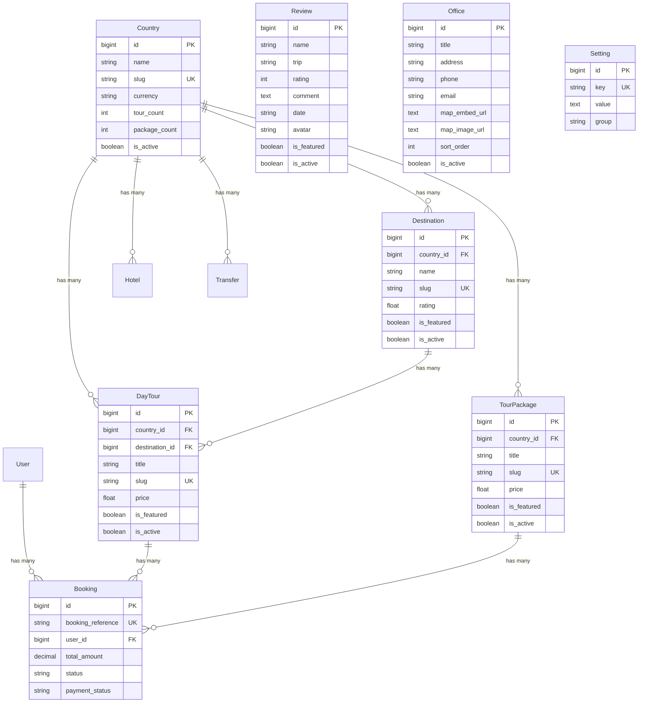
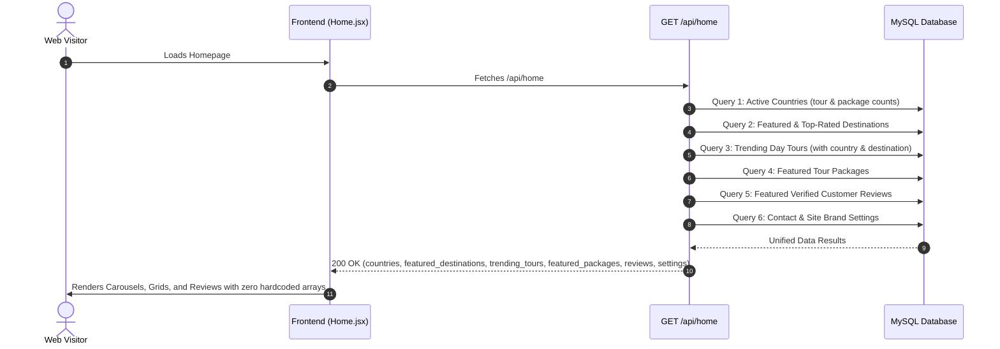

# PlanTripOnline (Backend API) — Project Context & Architectural Specification

> **Status:** Single Source of Truth for `plantrip-laravel`  
> **Repository Root:** `e:\Eurasia Holidays\plantrip\plantrip-laravel`  
> **Framework Target:** Laravel 12.x | PHP ^8.2 | Laravel Sanctum  
> **Production Base URL:** `https://backend.plantriponline.com`  
> **Document Generation Date:** October 2026 (Updated for Dynamic Data Architecture)  
> **Verification Level:** 100% verified against Laravel source code, database migrations, seeders, and companion frontend implementation  

---

## Table of Contents

1. [Project Overview](#1-project-overview)
2. [Backend Technology Stack and Versions](#2-backend-technology-stack-and-versions)
3. [Laravel Project Structure](#3-laravel-project-structure)
4. [Application Architecture](#4-application-architecture)
5. [Complete Backend Route and API Inventory](#5-complete-backend-route-and-api-inventory)
6. [Controllers and Methods](#6-controllers-and-methods)
7. [Services, Helpers, and Utilities](#7-services-helpers-and-utilities)
8. [Models and Database Relationships](#8-models-and-database-relationships)
9. [Database Tables and Migrations](#9-database-tables-and-migrations)
10. [Authentication, Middleware, and Permissions](#10-authentication-middleware-and-permissions)
11. [Complete Backend Functionality Inventory](#11-complete-backend-functionality-inventory)
12. [Business Rules and Execution Flows](#12-business-rules-and-execution-flows)
13. [Static-to-Dynamic Data Mapping & Frontend Integration Guide](#13-static-to-dynamic-data-mapping--frontend-integration-guide)
14. [Frontend-to-Backend Functionality Gap Analysis](#14-frontend-to-backend-functionality-gap-analysis)
15. [File Handling, Exports, Reports, and External Integrations](#15-file-handling-exports-reports-and-external-integrations)
16. [Environment Variables and Configuration (No Secrets)](#16-environment-variables-and-configuration-no-secrets)
17. [Validation, Security, and Error Handling](#17-validation-security-and-error-handling)
18. [Tests and Verification Status](#18-tests-and-verification-status)
19. [Setup and Development Instructions](#19-setup-and-development-instructions)
20. [Source File Reference Index](#20-source-file-reference-index)
21. [Instructions for Maintaining the Context File](#21-instructions-for-maintaining-the-context-file)

---

## 1. Project Overview

**`plantrip-laravel`** is the REST API backend service for the **PlanTripOnline** travel and tourism platform. It serves the companion Single Page Application (`PlanTripOnline-Frontend`) and manages the operational, transactional, content, and catalog data for destinations, day tours, multi-day tour packages, hotel listings, private vehicle transfers, bespoke customer enquiries, promo code validations, customer bookings, testimonials/reviews, branch office locations, brand settings, and administrative reporting.

The system is designed with an API-first approach, powered by Laravel Sanctum token-based authentication, structured Eloquent relational models, declarative migration schemas, seeders, and role-gated administrative endpoints.

### Primary Domain Responsibilities
- **Identity & Access Management:** User registration, credential authentication, personal access token issuance/revocation via Laravel Sanctum, and role validation.
- **Cross-Country & Regional Catalog:** Relational storage, global cross-country search, and country-filtered queries for regional destinations, day tours, package itineraries, accommodations, and ground transport.
- **Dynamic Content Management (CMS):** Customer reviews and testimonials, physical office locations and contact details, and site settings (social URLs, contact details, brand taglines).
- **Unified Feed:** High-performance composite feed (`GET /api/home`) delivering countries, featured destinations, trending tours, featured packages, verified reviews, and site settings in a single network round-trip.
- **Reservation & Booking Engine:** Creating structured booking records with automated reference generation (`BK-YYYY-XXXX`), passenger details, promo discounts, tax calculations, and status tracking.
- **Lead Intake Engine:** Processing bespoke vacation enquiries and custom itinerary requests.
- **Promo Code Engine:** Validating fixed and percentage discounts against dynamic usage limits, expiration timestamps, and order subtotals.
- **Administrative Intelligence:** Real-time platform KPI metrics (total users, active bookings, gross revenue, active packages, pending enquiries, recent bookings list) and 7-day revenue analytics.

---

## 2. Backend Technology Stack and Versions

### Core Runtime & Framework
- **PHP:** `^8.2` (Verified running CLI `PHP 8.2.12 ZTS`)
- **Laravel Framework:** `^12.0` (Laravel 12 skeleton with modern unified bootstrap in `bootstrap/app.php`)
- **Authentication:** **Laravel Sanctum** (`laravel/sanctum` via `HasApiTokens` trait on `User`)
- **Database Engine:** MySQL / MariaDB (production: `plantei5_plantrip`), SQLite for testing/local (`database/database.sqlite`)
- **Database Driver:** PDO MySQL / PDO SQLite

### Key Composer Dependencies ([`composer.json`](file:///e:/Eurasia%20Holidays/plantrip/plantrip-laravel/composer.json))
- `laravel/framework`: `^12.0`
- `laravel/tinker`: `^2.10.1` (Interactive REPL console)
- `fakerphp/faker`: `^1.23` (Dev: Mock data generator)
- `laravel/pail`: `^1.2.2` (Dev: Terminal log streaming)
- `laravel/pint`: `^1.13` (Dev: PHP code styling)
- `laravel/sail`: `^1.41` (Dev: Docker environment)
- `phpunit/phpunit`: `^11.5.3` (Dev: Testing framework)

---

## 3. Laravel Project Structure

```
plantrip-laravel/
├── app/
│   ├── Http/
│   │   ├── Controllers/
│   │   │   ├── AuthController.php          # Register, login, logout, password recovery
│   │   │   ├── BookingController.php       # Guest/user booking creation & admin management
│   │   │   ├── Controller.php              # Base Laravel controller
│   │   │   ├── CountryController.php       # Public catalog & admin CRUD for countries
│   │   │   ├── DashboardController.php     # Admin KPI metrics & 7-day chart data
│   │   │   ├── DayTourController.php       # Global & country day tours catalog, filters & admin CRUD
│   │   │   ├── DestinationController.php   # Global & country destinations catalog & admin CRUD
│   │   │   ├── EnquiryController.php       # Public lead capture & admin enquiry handling
│   │   │   ├── HomeController.php          # Unified homepage feed (destinations, tours, reviews, settings)
│   │   │   ├── HotelController.php         # Global & country accommodations catalog & admin CRUD
│   │   │   ├── OfficeController.php        # Physical office branches catalog & admin CRUD
│   │   │   ├── PromoCodeController.php     # Public validation & admin promo code CRUD
│   │   │   ├── ReviewController.php        # Customer reviews / testimonials & admin CRUD
│   │   │   ├── SettingController.php       # Key-value site settings & admin bulk updater
│   │   │   ├── TourPackageController.php   # Global & country multi-day itineraries & admin CRUD
│   │   │   ├── TransferController.php      # Ground transport routes & admin CRUD
│   │   │   └── UserController.php          # User profile & admin user management
│   │   └── Middleware/
│   │       └── AdminMiddleware.php         # Admin role guard ('admin@plantriponline.com')
│   ├── Models/
│   │   ├── Booking.php                     # Booking entity with auto BK reference generator
│   │   ├── Country.php                     # Country entity with relational child mappings
│   │   ├── DayTour.php                     # Day tour entity with JSON casts and is_featured flag
│   │   ├── Destination.php                 # Destination entity with JSON casts and is_featured flag
│   │   ├── Enquiry.php                     # Customer lead enquiry entity
│   │   ├── Hotel.php                       # Accommodation listing entity with amenities JSON
│   │   ├── Office.php                      # Physical branch office entity with map URLs
│   │   ├── PromoCode.php                   # Promo voucher discount entity
│   │   ├── Review.php                      # Testimonial and customer review entity
│   │   ├── Setting.php                     # Key-value configuration entity with get()/set()
│   │   ├── TourPackage.php                 # Tour package entity with JSON casts and is_featured flag
│   │   ├── Transfer.php                    # Ground transport entity with vehicles JSON
│   │   └── User.php                        # Authenticatable user with Sanctum tokens
│   └── Providers/
│       └── AppServiceProvider.php          # Default application service configuration
├── bootstrap/
│   └── app.php                             # Unified route registration, middleware aliases & exceptions
├── config/
│   ├── auth.php                            # User authentication guards & providers
│   ├── cors.php                            # Full Cross-Origin Resource Sharing configuration
│   ├── database.php                        # MySQL & SQLite connection drivers
│   ├── filesystems.php                     # Local & public storage disks
│   └── sanctum.php                         # Sanctum token authentication settings
├── database/
│   ├── migrations/                         # 18 declarative database migration files
│   └── seeders/
│       ├── DatabaseSeeder.php              # Master seeder invoking all specific seeders
│       ├── ThailandSeeder.php              # Thailand catalog data seeder
│       └── ContentSeeder.php               # Reviews, branch offices, and settings seeder
├── routes/
│   ├── api.php                             # 92 REST API route declarations
│   ├── web.php                             # 8 utility & web deployment routes
│   └── console.php                         # Artisan command closures
└── tests/
    ├── Feature/                            # Feature tests folder (empty / removed per project specification)
    ├── Unit/                               # Unit test cases
    └── TestCase.php
```

---

## 4. Application Architecture

```mermaid
graph TD
    subgraph ClientTier ["Frontend SPA (PlanTripOnline-Frontend)"]
        BrowserUI[React 18 SPA]
        APIClient[src/config/api.js (apiFetch)]
        LocalStorage[Browser localStorage (Bearer Token)]
    end

    subgraph MiddlewareLayer ["Laravel Request Pipeline"]
        RouteDispatcher[Laravel Router (routes/api.php)]
        Cors[CORS Middleware (config/cors.php)]
        SanctumMiddleware[auth:sanctum Guard]
        AdminGuard[AdminMiddleware ('admin' alias)]
    end

    subgraph ControllersLayer ["HTTP Controllers"]
        HomeCtrl[HomeController]
        CatalogCtrl[Country, Destination, DayTour, Hotel, Package, Transfer]
        ContentCtrl[ReviewController, OfficeController, SettingController]
        TransactionCtrl[BookingController, EnquiryController, PromoCodeController]
        AdminCtrl[DashboardController, UserController]
    end

    subgraph DataStorage ["Database & Persistence (MySQL / SQLite)"]
        DB[(Relational DB: 14 Core Tables)]
        Tokens[(personal_access_tokens Table)]
    end

    BrowserUI --> APIClient
    LocalStorage -.->|Bearer Token| APIClient
    APIClient -->|HTTPS JSON Request| RouteDispatcher
    RouteDispatcher --> Cors
    Cors --> SanctumMiddleware
    SanctumMiddleware --> AdminGuard

    RouteDispatcher -->|Public Routes| HomeCtrl
    RouteDispatcher -->|Public Routes| CatalogCtrl
    RouteDispatcher -->|Public Routes| ContentCtrl
    RouteDispatcher -->|Public Routes| TransactionCtrl

    SanctumMiddleware -->|Authenticated User Routes| TransactionCtrl
    SanctumMiddleware -->|Authenticated User Routes| AdminCtrl

    AdminGuard -->|Admin-Only Routes (/api/admin/*)| AdminCtrl
    AdminGuard -->|Admin-Only Routes (/api/admin/*)| CatalogCtrl
    AdminGuard -->|Admin-Only Routes (/api/admin/*)| ContentCtrl

    ControllersLayer --> DataStorage
    SanctumMiddleware -.-> Tokens
```

---

## 5. Complete Backend Route and API Inventory

The application defines **92 API routes** in [`routes/api.php`](file:///e:/Eurasia%20Holidays/plantrip/plantrip-laravel/routes/api.php) and **8 web utility routes** in [`routes/web.php`](file:///e:/Eurasia%20Holidays/plantrip/plantrip-laravel/routes/web.php).

### 1. Public API Endpoints (No Authentication Required)

| Method & Route | Controller & Method | Query / Body Parameters | Purpose & Output |
| :--- | :--- | :--- | :--- |
| `POST /api/register` | [`AuthController@register`](file:///e:/Eurasia%20Holidays/plantrip/plantrip-laravel/app/Http/Controllers/AuthController.php#L18) | `{ name, email, country, phone, password, password_confirmation }` | Creates user, issues Sanctum token, returns user object (`201 Created`). |
| `POST /api/login` | [`AuthController@login`](file:///e:/Eurasia%20Holidays/plantrip/plantrip-laravel/app/Http/Controllers/AuthController.php#L57) | `{ email, password }` | Authenticates credentials, revokes older tokens, returns new token (`200 OK`). |
| `POST /api/forgot-password` | [`AuthController@forgotPassword`](file:///e:/Eurasia%20Holidays/plantrip/plantrip-laravel/app/Http/Controllers/AuthController.php#L106) | `{ email }` | Dispatches password reset link token using Laravel Password broker. |
| `POST /api/reset-password` | [`AuthController@resetPassword`](file:///e:/Eurasia%20Holidays/plantrip/plantrip-laravel/app/Http/Controllers/AuthController.php#L123) | `{ token, email, password, password_confirmation }` | Resets user password using reset token. |
| `GET /api/home` | [`HomeController@index`](file:///e:/Eurasia%20Holidays/plantrip/plantrip-laravel/app/Http/Controllers/HomeController.php#L20) | None | Unified homepage feed: countries, featured destinations, trending tours, featured packages, verified reviews, and site settings. |
| `GET /api/countries` | [`CountryController@index`](file:///e:/Eurasia%20Holidays/plantrip/plantrip-laravel/app/Http/Controllers/CountryController.php#L14) | None | Lists all active countries ordered by name. |
| `GET /api/countries/{slug}` | [`CountryController@show`](file:///e:/Eurasia%20Holidays/plantrip/plantrip-laravel/app/Http/Controllers/CountryController.php#L27) | Path: `slug` | Full country detail with eager-loaded `destinations`, `dayTours`, `tourPackages`, `hotels`, and `transfers`. |
| `GET /api/destinations` | [`DestinationController@index`](file:///e:/Eurasia%20Holidays/plantrip/plantrip-laravel/app/Http/Controllers/DestinationController.php#L16) | Query: `search`, `country`, `featured`, `limit` | Global destinations list across all countries with optional search and filters. |
| `GET /api/destinations/{slug}` | [`DestinationController@show`](file:///e:/Eurasia%20Holidays/plantrip/plantrip-laravel/app/Http/Controllers/DestinationController.php#L54) | Path: `slug` | Destination detail with country relation and associated day tours list. |
| `GET /api/countries/{slug}/destinations` | [`DestinationController@byCountry`](file:///e:/Eurasia%20Holidays/plantrip/plantrip-laravel/app/Http/Controllers/DestinationController.php#L38) | Path: `slug` | Returns all active destinations within a specific country. |
| `GET /api/day-tours` *(Alias: `/api/tours`)* | [`DayTourController@index`](file:///e:/Eurasia%20Holidays/plantrip/plantrip-laravel/app/Http/Controllers/DayTourController.php#L17) | Query: `search`, `country`, `destination`, `location`, `featured`, `min_price`, `max_price`, `sort`, `limit` | Global day tours catalog across all countries with full filtering. |
| `GET /api/tours/{slug}` | [`DayTourController@show`](file:///e:/Eurasia%20Holidays/plantrip/plantrip-laravel/app/Http/Controllers/DayTourController.php#L72) | Path: `slug` | Full tour detail with eager-loaded `country` and `destination`. |
| `GET /api/countries/{slug}/day-tours` | [`DayTourController@byCountry`](file:///e:/Eurasia%20Holidays/plantrip/plantrip-laravel/app/Http/Controllers/DayTourController.php#L41) | Path: `slug`<br>Query: `location`, `min_price`, `max_price`, `sort` | Lists day tours for a specific country with filtering. |
| `GET /api/tour-packages` *(Alias: `/api/packages`)* | [`TourPackageController@index`](file:///e:/Eurasia%20Holidays/plantrip/plantrip-laravel/app/Http/Controllers/TourPackageController.php#L16) | Query: `search`, `country`, `featured`, `duration`, `type`, `sort`, `limit` | Global multi-day tour packages catalog across all countries. |
| `GET /api/packages/{slug}` | [`TourPackageController@show`](file:///e:/Eurasia%20Holidays/plantrip/plantrip-laravel/app/Http/Controllers/TourPackageController.php#L68) | Path: `slug` | Full package detail with eager-loaded `country`. |
| `GET /api/countries/{slug}/tour-packages` | [`TourPackageController@byCountry`](file:///e:/Eurasia%20Holidays/plantrip/plantrip-laravel/app/Http/Controllers/TourPackageController.php#L41) | Path: `slug`<br>Query: `duration`, `type`, `sort` | Multi-day tour packages for a specific country. |
| `GET /api/hotels` | [`HotelController@index`](file:///e:/Eurasia%20Holidays/plantrip/plantrip-laravel/app/Http/Controllers/HotelController.php#L16) | Query: `search`, `country`, `category`, `stars`, `min_price`, `max_price`, `sort`, `limit` | Global hotel listings across all countries with category and star filtering. |
| `GET /api/hotels/{slug}` | [`HotelController@show`](file:///e:/Eurasia%20Holidays/plantrip/plantrip-laravel/app/Http/Controllers/HotelController.php#L78) | Path: `slug` | Full accommodation listing detail with eager-loaded `country`. |
| `GET /api/countries/{slug}/hotels` | [`HotelController@byCountry`](file:///e:/Eurasia%20Holidays/plantrip/plantrip-laravel/app/Http/Controllers/HotelController.php#L41) | Path: `slug`<br>Query: filters | Accommodation listings for a specific country. |
| `GET /api/transfers` | [`TransferController@index`](file:///e:/Eurasia%20Holidays/plantrip/plantrip-laravel/app/Http/Controllers/TransferController.php#L16) | Query: `search`, `country`, `limit` | Global ground transport routes across all countries. |
| `GET /api/transfers/{slug}` | [`TransferController@show`](file:///e:/Eurasia%20Holidays/plantrip/plantrip-laravel/app/Http/Controllers/TransferController.php#L57) | Path: `slug` | Ground transport detail with vehicle fleet and route descriptions. |
| `GET /api/countries/{slug}/transfers` | [`TransferController@byCountry`](file:///e:/Eurasia%20Holidays/plantrip/plantrip-laravel/app/Http/Controllers/TransferController.php#L41) | Path: `slug` | Private transfer routes for a specific country. |
| `GET /api/reviews` | [`ReviewController@index`](file:///e:/Eurasia%20Holidays/plantrip/plantrip-laravel/app/Http/Controllers/ReviewController.php#L15) | Query: `featured`, `trip`, `rating`, `limit` | Verified customer testimonials and reviews. |
| `GET /api/reviews/{id}` | [`ReviewController@show`](file:///e:/Eurasia%20Holidays/plantrip/plantrip-laravel/app/Http/Controllers/ReviewController.php#L39) | Path: `id` | Single review detail. |
| `GET /api/offices` | [`OfficeController@index`](file:///e:/Eurasia%20Holidays/plantrip/plantrip-laravel/app/Http/Controllers/OfficeController.php#L14) | None | Physical branch office locations in presentation sort order. |
| `GET /api/offices/{id}` | [`OfficeController@show`](file:///e:/Eurasia%20Holidays/plantrip/plantrip-laravel/app/Http/Controllers/OfficeController.php#L27) | Path: `id` | Single branch office detail. |
| `GET /api/settings` | [`SettingController@index`](file:///e:/Eurasia%20Holidays/plantrip/plantrip-laravel/app/Http/Controllers/SettingController.php#L14) | Query: `group` | Public site configuration dictionary (phone, email, socials, address). |
| `POST /api/enquiries` | [`EnquiryController@store`](file:///e:/Eurasia%20Holidays/plantrip/plantrip-laravel/app/Http/Controllers/EnquiryController.php#L14) | `{ full_name, email, phone, country, destination, travel_type, start_date, duration, message }` | Validates and creates a new customer enquiry lead (`201 Created`). |
| `POST /api/promo-codes/validate` | [`PromoCodeController@validate`](file:///e:/Eurasia%20Holidays/plantrip/plantrip-laravel/app/Http/Controllers/PromoCodeController.php#L14) | `{ code, total_amount }` | Validates promo code active status, expiration, and min amount. Returns discount amount. |
| `POST /api/bookings` | [`BookingController@store`](file:///e:/Eurasia%20Holidays/plantrip/plantrip-laravel/app/Http/Controllers/BookingController.php#L16) | Complete reservation payload (supports both snake_case and camelCase) | Creates booking with reference `BK-YYYY-XXXX`, increments promo usage, associates user if token provided (`201 Created`). |

---

### 2. Authenticated User Endpoints (`auth:sanctum`)

| Method & Route | Controller & Method | Headers | Body / Query | Purpose & Output |
| :--- | :--- | :--- | :--- | :--- |
| `POST /api/logout` | [`AuthController@logout`](file:///e:/Eurasia%20Holidays/plantrip/plantrip-laravel/app/Http/Controllers/AuthController.php#L95) | `Authorization: Bearer <token>` | None | Revokes the current access token. |
| `GET /api/user` | [`UserController@profile`](file:///e:/Eurasia%20Holidays/plantrip/plantrip-laravel/app/Http/Controllers/UserController.php#L15) | `Authorization: Bearer <token>` | None | Returns user profile, dynamic role, `upcoming_trips_count`, `past_trips_count`, and `total_bookings_count`. |
| `PUT /api/user` | [`UserController@update`](file:///e:/Eurasia%20Holidays/plantrip/plantrip-laravel/app/Http/Controllers/UserController.php#L49) | `Authorization: Bearer <token>` | `{ name?, phone?, country? }` | Updates authenticated user profile details. |
| `GET /api/bookings` | [`BookingController@myBookings`](file:///e:/Eurasia%20Holidays/plantrip/plantrip-laravel/app/Http/Controllers/BookingController.php#L85) | `Authorization: Bearer <token>` | None | Returns list of bookings created by the authenticated user. |
| `GET /api/bookings/{id}` | [`BookingController@show`](file:///e:/Eurasia%20Holidays/plantrip/plantrip-laravel/app/Http/Controllers/BookingController.php#L98) | `Authorization: Bearer <token>` | Path: `id` | Returns single booking detail belonging to the user with tour/package relations. |

---

### 3. Admin-Only Endpoints (`auth:sanctum`, `admin` middleware)

| Method & Route | Controller & Method | Parameters | Purpose |
| :--- | :--- | :--- | :--- |
| `GET /api/users` *(Alias)* | [`UserController@index`](file:///e:/Eurasia%20Holidays/plantrip/plantrip-laravel/app/Http/Controllers/UserController.php#L79) | None | Lists all registered users with role and registration dates (matches frontend `UsersList.jsx`). |
| `GET /api/users/{id}` *(Alias)* | [`UserController@show`](file:///e:/Eurasia%20Holidays/plantrip/plantrip-laravel/app/Http/Controllers/UserController.php#L101) | Path: `id` | Returns specific user profile details. |
| `PUT /api/users/{id}` *(Alias)* | [`UserController@adminUpdate`](file:///e:/Eurasia%20Holidays/plantrip/plantrip-laravel/app/Http/Controllers/UserController.php#L121) | Path: `id`, Body: `{ name?, phone?, country? }` | Updates any user profile. |
| `DELETE /api/users/{id}` *(Alias)* | [`UserController@destroy`](file:///e:/Eurasia%20Holidays/plantrip/plantrip-laravel/app/Http/Controllers/UserController.php#L140) | Path: `id` | Deletes user and associated tokens (prevents self-deletion). |
| `GET /api/admin/dashboard/stats` | [`DashboardController@stats`](file:///e:/Eurasia%20Holidays/plantrip/plantrip-laravel/app/Http/Controllers/DashboardController.php#L17) | None | Returns platform stats (total users, active bookings, revenue, packages, recent bookings list, 7-day revenue chart data, activity feed). |
| `GET /api/admin/users` | [`UserController@index`](file:///e:/Eurasia%20Holidays/plantrip/plantrip-laravel/app/Http/Controllers/UserController.php#L79) | None | Lists all registered users. |
| `GET /api/admin/users/{id}` | [`UserController@show`](file:///e:/Eurasia%20Holidays/plantrip/plantrip-laravel/app/Http/Controllers/UserController.php#L101) | Path: `id` | Returns specific user profile details. |
| `PUT /api/admin/users/{id}` | [`UserController@adminUpdate`](file:///e:/Eurasia%20Holidays/plantrip/plantrip-laravel/app/Http/Controllers/UserController.php#L121) | Path: `id`, Body: updates | Updates any user profile. |
| `DELETE /api/admin/users/{id}` | [`UserController@destroy`](file:///e:/Eurasia%20Holidays/plantrip/plantrip-laravel/app/Http/Controllers/UserController.php#L140) | Path: `id` | Deletes user and associated tokens. |
| `GET /api/admin/countries` | [`CountryController@adminIndex`](file:///e:/Eurasia%20Holidays/plantrip/plantrip-laravel/app/Http/Controllers/CountryController.php#L49) | None | Lists all countries including inactive entries. |
| `POST /api/admin/countries` | [`CountryController@store`](file:///e:/Eurasia%20Holidays/plantrip/plantrip-laravel/app/Http/Controllers/CountryController.php#L58) | Body: Country attributes | Creates a new country entity. |
| `PUT /api/admin/countries/{id}` | [`CountryController@update`](file:///e:/Eurasia%20Holidays/plantrip/plantrip-laravel/app/Http/Controllers/CountryController.php#L80) | Path: `id`, Body: Updates | Updates country details and status. |
| `DELETE /api/admin/countries/{id}` | [`CountryController@destroy`](file:///e:/Eurasia%20Holidays/plantrip/plantrip-laravel/app/Http/Controllers/CountryController.php#L103) | Path: `id` | Deletes country and cascade deletes child entities. |
| `GET /api/admin/destinations` | [`DestinationController@index`](file:///e:/Eurasia%20Holidays/plantrip/plantrip-laravel/app/Http/Controllers/DestinationController.php#L16) | None | Lists all destinations. |
| `POST /api/admin/destinations` | [`DestinationController@store`](file:///e:/Eurasia%20Holidays/plantrip/plantrip-laravel/app/Http/Controllers/DestinationController.php#L72) | Body: Destination attributes | Creates a new regional destination with `highlights` JSON array and `is_featured`. |
| `PUT /api/admin/destinations/{id}` | [`DestinationController@update`](file:///e:/Eurasia%20Holidays/plantrip/plantrip-laravel/app/Http/Controllers/DestinationController.php#L95) | Path: `id`, Body: Updates | Updates destination attributes and featured status. |
| `DELETE /api/admin/destinations/{id}` | [`DestinationController@destroy`](file:///e:/Eurasia%20Holidays/plantrip/plantrip-laravel/app/Http/Controllers/DestinationController.php#L118) | Path: `id` | Deletes destination. |
| `GET /api/admin/day-tours` | [`DayTourController@adminIndex`](file:///e:/Eurasia%20Holidays/plantrip/plantrip-laravel/app/Http/Controllers/DayTourController.php#L85) | None | Lists all day tours with country relations. |
| `POST /api/admin/day-tours` | [`DayTourController@store`](file:///e:/Eurasia%20Holidays/plantrip/plantrip-laravel/app/Http/Controllers/DayTourController.php#L93) | Body: DayTour attributes | Creates a new day tour with features/itinerary arrays and `is_featured`. |
| `PUT /api/admin/day-tours/{id}` | [`DayTourController@update`](file:///e:/Eurasia%20Holidays/plantrip/plantrip-laravel/app/Http/Controllers/DayTourController.php#L122) | Path: `id`, Body: Updates | Updates day tour details. |
| `DELETE /api/admin/day-tours/{id}` | [`DayTourController@destroy`](file:///e:/Eurasia%20Holidays/plantrip/plantrip-laravel/app/Http/Controllers/DayTourController.php#L151) | Path: `id` | Deletes day tour. |
| `GET /api/admin/tour-packages` | [`TourPackageController@adminIndex`](file:///e:/Eurasia%20Holidays/plantrip/plantrip-laravel/app/Http/Controllers/TourPackageController.php#L81) | None | Lists all tour packages with country relations. |
| `POST /api/admin/tour-packages` | [`TourPackageController@store`](file:///e:/Eurasia%20Holidays/plantrip/plantrip-laravel/app/Http/Controllers/TourPackageController.php#L89) | Body: TourPackage attributes | Creates a new multi-day package itinerary with `is_featured`. |
| `PUT /api/admin/tour-packages/{id}` | [`TourPackageController@update`](file:///e:/Eurasia%20Holidays/plantrip/plantrip-laravel/app/Http/Controllers/TourPackageController.php#L116) | Path: `id`, Body: Updates | Updates package itinerary details. |
| `DELETE /api/admin/tour-packages/{id}` | [`TourPackageController@destroy`](file:///e:/Eurasia%20Holidays/plantrip/plantrip-laravel/app/Http/Controllers/TourPackageController.php#L143) | Path: `id` | Deletes tour package. |
| `GET /api/admin/hotels` | [`HotelController@adminIndex`](file:///e:/Eurasia%20Holidays/plantrip/plantrip-laravel/app/Http/Controllers/HotelController.php#L91) | None | Lists all hotel listings with country relations. |
| `POST /api/admin/hotels` | [`HotelController@store`](file:///e:/Eurasia%20Holidays/plantrip/plantrip-laravel/app/Http/Controllers/HotelController.php#L99) | Body: Hotel attributes | Creates a new accommodation entry. |
| `PUT /api/admin/hotels/{id}` | [`HotelController@update`](file:///e:/Eurasia%20Holidays/plantrip/plantrip-laravel/app/Http/Controllers/HotelController.php#L126) | Path: `id`, Body: Updates | Updates accommodation listing details. |
| `DELETE /api/admin/hotels/{id}` | [`HotelController@destroy`](file:///e:/Eurasia%20Holidays/plantrip/plantrip-laravel/app/Http/Controllers/HotelController.php#L154) | Path: `id` | Deletes hotel listing. |
| `GET /api/admin/transfers` | [`TransferController@adminIndex`](file:///e:/Eurasia%20Holidays/plantrip/plantrip-laravel/app/Http/Controllers/TransferController.php#L70) | None | Lists all private transfer options with country relations. |
| `POST /api/admin/transfers` | [`TransferController@store`](file:///e:/Eurasia%20Holidays/plantrip/plantrip-laravel/app/Http/Controllers/TransferController.php#L78) | Body: Transfer attributes | Creates a private transport route. |
| `PUT /api/admin/transfers/{id}` | [`TransferController@update`](file:///e:/Eurasia%20Holidays/plantrip/plantrip-laravel/app/Http/Controllers/TransferController.php#L100) | Path: `id`, Body: Updates | Updates private transport route. |
| `DELETE /api/admin/transfers/{id}` | [`TransferController@destroy`](file:///e:/Eurasia%20Holidays/plantrip/plantrip-laravel/app/Http/Controllers/TransferController.php#L122) | Path: `id` | Deletes transfer route. |
| `GET /api/admin/enquiries` | [`EnquiryController@index`](file:///e:/Eurasia%20Holidays/plantrip/plantrip-laravel/app/Http/Controllers/EnquiryController.php#L42) | Query: `status`, `per_page` | Paginated list of customer enquiries. |
| `GET /api/admin/enquiries/{id}` | [`EnquiryController@show`](file:///e:/Eurasia%20Holidays/plantrip/plantrip-laravel/app/Http/Controllers/EnquiryController.php#L60) | Path: `id` | Returns single customer enquiry record. |
| `PUT /api/admin/enquiries/{id}` | [`EnquiryController@update`](file:///e:/Eurasia%20Holidays/plantrip/plantrip-laravel/app/Http/Controllers/EnquiryController.php#L70) | Path: `id`, Body: `{ status, notes }` | Updates enquiry status (`pending`, `in_progress`, `completed`, `cancelled`) and notes. |
| `DELETE /api/admin/enquiries/{id}` | [`EnquiryController@destroy`](file:///e:/Eurasia%20Holidays/plantrip/plantrip-laravel/app/Http/Controllers/EnquiryController.php#L91) | Path: `id` | Deletes customer enquiry. |
| `GET /api/admin/bookings` | [`BookingController@adminIndex`](file:///e:/Eurasia%20Holidays/plantrip/plantrip-laravel/app/Http/Controllers/BookingController.php#L114) | Query: `status`, `payment_status`, `date_from`, `date_to`, `per_page` | Paginated bookings list with aggregate stats (total bookings, revenue, pending). |
| `GET /api/admin/bookings/{id}` | [`BookingController@adminShow`](file:///e:/Eurasia%20Holidays/plantrip/plantrip-laravel/app/Http/Controllers/BookingController.php#L153) | Path: `id` | Full booking details with customer, tour, and package relations. |
| `PUT /api/admin/bookings/{id}` | [`BookingController@adminUpdate`](file:///e:/Eurasia%20Holidays/plantrip/plantrip-laravel/app/Http/Controllers/BookingController.php#L168) | Path: `id`, Body: `{ status, payment_status, admin_notes }` | Updates booking status (`pending`, `confirmed`, `cancelled`, `completed`) and payment. |
| `DELETE /api/admin/bookings/{id}` | [`BookingController@adminDestroy`](file:///e:/Eurasia%20Holidays/plantrip/plantrip-laravel/app/Http/Controllers/BookingController.php#L190) | Path: `id` | Deletes booking record. |
| `GET /api/admin/promo-codes` | [`PromoCodeController@index`](file:///e:/Eurasia%20Holidays/plantrip/plantrip-laravel/app/Http/Controllers/PromoCodeController.php#L52) | None | Lists all promotional discount vouchers. |
| `POST /api/admin/promo-codes` | [`PromoCodeController@store`](file:///e:/Eurasia%20Holidays/plantrip/plantrip-laravel/app/Http/Controllers/PromoCodeController.php#L58) | Body: `{ code, discount_type, discount_value, min_amount, max_uses, expires_at, is_active }` | Creates a new promotional discount voucher. |
| `PUT /api/admin/promo-codes/{id}` | [`PromoCodeController@update`](file:///e:/Eurasia%20Holidays/plantrip/plantrip-laravel/app/Http/Controllers/PromoCodeController.php#L76) | Path: `id`, Body: Updates | Modifies voucher rules and expiration. |
| `DELETE /api/admin/promo-codes/{id}` | [`PromoCodeController@destroy`](file:///e:/Eurasia%20Holidays/plantrip/plantrip-laravel/app/Http/Controllers/PromoCodeController.php#L94) | Path: `id` | Deletes promotional voucher. |
| `GET /api/admin/reviews` | [`ReviewController@adminIndex`](file:///e:/Eurasia%20Holidays/plantrip/plantrip-laravel/app/Http/Controllers/ReviewController.php#L50) | None | Lists all reviews including inactive entries. |
| `POST /api/admin/reviews` | [`ReviewController@store`](file:///e:/Eurasia%20Holidays/plantrip/plantrip-laravel/app/Http/Controllers/ReviewController.php#L58) | Body: Review attributes | Creates a customer review or testimonial. |
| `PUT /api/admin/reviews/{id}` | [`ReviewController@update`](file:///e:/Eurasia%20Holidays/plantrip/plantrip-laravel/app/Http/Controllers/ReviewController.php#L78) | Path: `id`, Body: Updates | Updates review content, rating, or active/featured status. |
| `DELETE /api/admin/reviews/{id}` | [`ReviewController@destroy`](file:///e:/Eurasia%20Holidays/plantrip/plantrip-laravel/app/Http/Controllers/ReviewController.php#L100) | Path: `id` | Deletes review record. |
| `GET /api/admin/offices` | [`OfficeController@adminIndex`](file:///e:/Eurasia%20Holidays/plantrip/plantrip-laravel/app/Http/Controllers/OfficeController.php#L38) | None | Lists all physical branch offices. |
| `POST /api/admin/offices` | [`OfficeController@store`](file:///e:/Eurasia%20Holidays/plantrip/plantrip-laravel/app/Http/Controllers/OfficeController.php#L46) | Body: Office attributes | Creates a new branch office record. |
| `PUT /api/admin/offices/{id}` | [`OfficeController@update`](file:///e:/Eurasia%20Holidays/plantrip/plantrip-laravel/app/Http/Controllers/OfficeController.php#L66) | Path: `id`, Body: Updates | Updates office address, phone, email, or map URLs. |
| `DELETE /api/admin/offices/{id}` | [`OfficeController@destroy`](file:///e:/Eurasia%20Holidays/plantrip/plantrip-laravel/app/Http/Controllers/OfficeController.php#L88) | Path: `id` | Deletes branch office record. |
| `GET /api/admin/settings` | [`SettingController@adminIndex`](file:///e:/Eurasia%20Holidays/plantrip/plantrip-laravel/app/Http/Controllers/SettingController.php#L32) | None | Lists all site settings grouped and ordered. |
| `PUT /api/admin/settings` | [`SettingController@update`](file:///e:/Eurasia%20Holidays/plantrip/plantrip-laravel/app/Http/Controllers/SettingController.php#L41) | Body: `{ settings: { key: value }, group?: string }` | Bulk updates key-value site configurations. |

---

### 4. Web Utility & Ops Routes ([`routes/web.php`](file:///e:/Eurasia%20Holidays/plantrip/plantrip-laravel/routes/web.php))

| Method & Route | Handlers / Logic | Purpose |
| :--- | :--- | :--- |
| `GET /` | `view('welcome')` | Default welcome view. |
| `GET /create-admin` | Closure creating user `admin@plantriponline.com` | One-click seeder creating the master admin user account. |
| `GET /storage-link` | Symlink helper linking `storage/app/public` to `public/storage` | Creates storage symlink on shared hosting environments. |
| `GET /migrate` | `Artisan::call('migrate', ['--force' => true])` | Web runner for database migrations. |
| `GET /db-seed` | `Artisan::call('db:seed', ['--force' => true])` | Web runner for database seeders. |
| `POST /deploy` | Webhook triggered with `?token=DEPLOY_SECRET` | Auto-deployment webhook: git pull, composer install, migrate, cache clear/optimize. |
| `GET /git` | Shell calls `git status`, `git log`, `git remote` | Diagnostic endpoint returning current git commit and branch info. |
| `GET /clear-cache` | `Artisan::call('optimize:clear')` | Web runner clearing configuration, routing, and view caches. |

---

## 6. Controllers and Methods

All controllers reside in [`app/Http/Controllers/`](file:///e:/Eurasia%20Holidays/plantrip/plantrip-laravel/app/Http/Controllers/):

1. **[`HomeController.php`](file:///e:/Eurasia%20Holidays/plantrip/plantrip-laravel/app/Http/Controllers/HomeController.php):**
   - `index(Request)`: Assembles composite feed delivering `countries`, `featured_destinations` (with country relation), `trending_tours` (with country & destination relations), `featured_packages` (with country relation), `reviews`, and `settings` dictionary.
2. **[`ReviewController.php`](file:///e:/Eurasia%20Holidays/plantrip/plantrip-laravel/app/Http/Controllers/ReviewController.php):**
   - `index(Request)`: Public listing of active reviews with `?featured=1`, `?rating=5`, `?trip=...`, and `?limit=...` filtering.
   - `show($id)`: Public single active review detail.
   - `adminIndex()`, `store()`, `update()`, `destroy()`: Admin CRUD for managing reviews.
3. **[`OfficeController.php`](file:///e:/Eurasia%20Holidays/plantrip/plantrip-laravel/app/Http/Controllers/OfficeController.php):**
   - `index()`: Public listing of active offices ordered by `sort_order`.
   - `show($id)`: Public single office detail.
   - `adminIndex()`, `store()`, `update()`, `destroy()`: Admin CRUD for managing branch locations.
4. **[`SettingController.php`](file:///e:/Eurasia%20Holidays/plantrip/plantrip-laravel/app/Http/Controllers/SettingController.php):**
   - `index(Request)`: Public key-value dictionary with optional `?group=...` filtering.
   - `adminIndex()`: Admin list of all settings with metadata.
   - `update(Request)`: Admin bulk updater updating multiple key-value pairs in a single transaction.
5. **[`DestinationController.php`](file:///e:/Eurasia%20Holidays/plantrip/plantrip-laravel/app/Http/Controllers/DestinationController.php):**
   - `index(Request)`: Global destinations query across all countries with `search`, `country` (slug/ID), `featured`, and `limit`.
   - `byCountry($slug)`: Filter destinations by country slug.
   - `show($slug)`: Loads destination with linked day tours.
   - `store()`, `update()`, `destroy()`: Admin CRUD managing highlights array and `is_featured` flag.
6. **[`DayTourController.php`](file:///e:/Eurasia%20Holidays/plantrip/plantrip-laravel/app/Http/Controllers/DayTourController.php):**
   - `index(Request)`: Global day tours query across all countries with `search`, `country`, `destination`, `location`, `featured`, `price`, and `sort`.
   - `byCountry(Request, $slug)`: Tours filtered by country slug.
   - `show($slug)`: Tour detail with country and destination relations.
   - `adminIndex()`, `store()`, `update()`, `destroy()`: Admin CRUD managing features, inclusions, exclusions, itinerary, and `is_featured`.
7. **[`TourPackageController.php`](file:///e:/Eurasia%20Holidays/plantrip/plantrip-laravel/app/Http/Controllers/TourPackageController.php):**
   - `index(Request)`: Global tour packages query across all countries with `search`, `country`, `featured`, `duration`, and `sort`.
   - `byCountry(Request, $slug)`: Tour packages for specific country.
   - `show($slug)`: Full package details with country relation.
   - `adminIndex()`, `store()`, `update()`, `destroy()`: Admin CRUD managing includes, itinerary, highlights, and `is_featured`.
8. **[`HotelController.php`](file:///e:/Eurasia%20Holidays/plantrip/plantrip-laravel/app/Http/Controllers/HotelController.php):**
   - `index(Request)`: Global accommodations query across all countries with `search`, `country`, `category`, and star rating.
   - `byCountry(Request, $slug)`: Hotels for specific country.
   - `show($slug)`: Full hotel detail.
   - `adminIndex()`, `store()`, `update()`, `destroy()`: Admin CRUD managing amenities and pricing.
9. **[`TransferController.php`](file:///e:/Eurasia%20Holidays/plantrip/plantrip-laravel/app/Http/Controllers/TransferController.php):**
   - `index(Request)`: Global ground transport routes across all countries.
   - `byCountry($slug)`: Ground transport routes for specific country.
   - `show($slug)`: Transfer detail with vehicle fleet.
   - `adminIndex()`, `store()`, `update()`, `destroy()`: Admin CRUD.
10. **[`DashboardController.php`](file:///e:/Eurasia%20Holidays/plantrip/plantrip-laravel/app/Http/Controllers/DashboardController.php):**
    - `stats()`: Returns total users, active bookings, total revenue, active packages count, pending enquiries, 7-day revenue chart data, activity feed, and **recent bookings list** with formatted dates, amounts, and statuses.
11. **[`UserController.php`](file:///e:/Eurasia%20Holidays/plantrip/plantrip-laravel/app/Http/Controllers/UserController.php):**
    - `profile(Request)`: User profile with dynamic role calculation and dynamic counters: `upcoming_trips_count`, `past_trips_count`, and `total_bookings_count`.
    - `update(Request)`: Updates authenticated user's name, phone, country.
    - `index()`, `show()`, `adminUpdate()`, `destroy()`: Admin user management endpoints.
12. **[`AuthController.php`](file:///e:/Eurasia%20Holidays/plantrip/plantrip-laravel/app/Http/Controllers/AuthController.php):**
    - `register(Request)`: Issues Sanctum token, returns user object.
    - `login(Request)`: Checks credentials, revokes older tokens, issues token.
    - `logout(Request)`: Deletes `currentAccessToken()`.
    - `forgotPassword(Request)`, `resetPassword(Request)`: Password broker workflows.
13. **[`BookingController.php`](file:///e:/Eurasia%20Holidays/plantrip/plantrip-laravel/app/Http/Controllers/BookingController.php):**
    - `store(Request)`: Supports snake_case and camelCase parameters, kids arrays, generates `BK-YYYY-XXXX`.
    - `myBookings(Request)`: Returns user bookings.
    - `show(Request, $id)`: Returns user booking detail.
    - `adminIndex()`, `adminShow()`, `adminUpdate()`, `adminDestroy()`: Admin bookings management.
14. **[`EnquiryController.php`](file:///e:/Eurasia%20Holidays/plantrip/plantrip-laravel/app/Http/Controllers/EnquiryController.php):**
    - `store(Request)`: Lead capture with full_name / name alias support.
    - `index()`, `show()`, `update()`, `destroy()`: Admin lead triage.
15. **[`PromoCodeController.php`](file:///e:/Eurasia%20Holidays/plantrip/plantrip-laravel/app/Http/Controllers/PromoCodeController.php):**
    - `validate(Request)`: Checks active status, expiration, max uses, min order threshold, and returns discount amount.
    - `index()`, `store()`, `update()`, `destroy()`: Admin promo voucher management.

---

## 7. Services, Helpers, and Utilities

- **Reference Generator:** [`Booking::generateReference()`](file:///e:/Eurasia%20Holidays/plantrip/plantrip-laravel/app/Models/Booking.php) creates human-readable references formatted `BK-YYYY-XXXX` based on yearly incremental IDs.
- **Dynamic Role Resolver:** Dynamic role resolution in `UserController@profile` and `AdminMiddleware` checking master administrative email `admin@plantriponline.com`.
- **Dynamic Trip Counter:** Database-driven aggregation on `Booking` checking `travel_date >= now()` vs `< now()` for upcoming/past trip counters.
- **Key-Value Settings Engine:** [`Setting::get($key, $default)`](file:///e:/Eurasia%20Holidays/plantrip/plantrip-laravel/app/Models/Setting.php) and [`Setting::set($key, $value, $group)`](file:///e:/Eurasia%20Holidays/plantrip/plantrip-laravel/app/Models/Setting.php) providing unified configuration storage and retrieval.

---

## 8. Models and Database Relationships



---

## 9. Database Tables and Migrations

Migrated tables in [`database/migrations/`](file:///e:/Eurasia%20Holidays/plantrip/plantrip-laravel/database/migrations/):

| Migration File | Created / Altered Table | Primary Columns & Types | Constraints & Purpose |
| :--- | :--- | :--- | :--- |
| `0001_01_01_000000_create_users_table.php` | `users`, `password_reset_tokens`, `sessions` | `users`: `id`, `name`, `email`, `password`, `created_at` | `email` UNIQUE |
| `0001_01_01_000001_create_cache_table.php` | `cache`, `cache_locks` | `key`, `value`, `expiration` | Laravel cache driver |
| `0001_01_01_000002_create_jobs_table.php` | `jobs`, `job_batches`, `failed_jobs` | Job queues and batch tracking | Queue worker storage |
| `2026_09_30_104625_add_country_and_phone_to_users_table.php` | `users` (Alter) | `country` (string), `phone` (string) | Added user profile fields |
| `2026_09_30_105113_create_personal_access_tokens_table.php` | `personal_access_tokens` | `id`, `tokenable_type`, `tokenable_id`, `name`, `token` | Sanctum authentication tokens |
| `2026_10_15_000001_create_countries_table.php` | `countries` | `id`, `name`, `slug`, `flag`, `currency`, `hero_image`, `tour_count`, `package_count`, `is_active` | `slug` UNIQUE |
| `2026_10_15_000002_create_destinations_table.php` | `destinations` | `id`, `country_id`, `name`, `slug`, `image`, `badge`, `rating`, `highlights` (json), `is_active` | `slug` UNIQUE, FK `country_id` cascade |
| `2026_10_15_000003_create_day_tours_table.php` | `day_tours` | `id`, `country_id`, `destination_id`, `slug`, `title`, `price`, `features` (json), `itinerary` (json), `is_active` | `slug` UNIQUE, FKs with cascade & set null |
| `2026_10_15_000004_create_tour_packages_table.php` | `tour_packages` | `id`, `country_id`, `slug`, `title`, `duration`, `price`, `includes` (json), `itinerary` (json), `is_active` | `slug` UNIQUE, FK `country_id` cascade |
| `2026_10_15_000005_create_hotels_table.php` | `hotels` | `id`, `country_id`, `slug`, `title`, `category`, `stars`, `price_per_night`, `amenities` (json), `is_active` | `slug` UNIQUE, FK `country_id` cascade |
| `2026_10_15_000006_create_transfers_table.php` | `transfers` | `id`, `country_id`, `slug`, `title`, `from_location`, `to_location`, `duration`, `price`, `vehicles` (json), `is_active` | `slug` UNIQUE, FK `country_id` cascade |
| `2026_10_15_000007_create_enquiries_table.php` | `enquiries` | `id`, `full_name`, `email`, `phone`, `country`, `destination`, `travel_type`, `start_date`, `duration`, `message`, `status`, `notes` | Lead capture storage |
| `2026_10_15_000008_create_promo_codes_table.php` | `promo_codes` | `id`, `code`, `discount_type`, `discount_value`, `min_amount`, `max_uses`, `uses_count`, `expires_at`, `is_active` | `code` UNIQUE |
| `2026_10_15_000009_create_bookings_table.php` | `bookings` | `id`, `booking_reference`, `user_id`, `tour_id`, `package_id`, `destination`, `total_amount`, `status`, `payment_status` | `booking_reference` UNIQUE |
| `2026_10_27_000001_add_is_featured_to_catalog_tables.php` | `destinations`, `day_tours`, `tour_packages` (Alter) | `is_featured` (boolean default false, indexed) | Promotes top catalog items to homepage grids |
| `2026_10_27_000002_create_reviews_table.php` | `reviews` | `id`, `name`, `trip`, `rating`, `comment`, `date`, `avatar`, `is_featured`, `is_active` | Dynamic testimonials and customer reviews |
| `2026_10_27_000003_create_offices_table.php` | `offices` | `id`, `title`, `address`, `phone`, `email`, `map_embed_url`, `map_image_url`, `sort_order`, `is_active` | Physical branch office addresses & contact info |
| `2026_10_27_000004_create_settings_table.php` | `settings` | `id`, `key` (string unique), `value` (text nullable), `group` (string default 'general') | Centralized platform configuration dictionary |

---

## 10. Authentication, Middleware, and Permissions

### Sanctum Token Authentication
- Configured in [`config/sanctum.php`](file:///e:/Eurasia%20Holidays/plantrip/plantrip-laravel/config/sanctum.php).
- Model [`User`](file:///e:/Eurasia%20Holidays/plantrip/plantrip-laravel/app/Models/User.php) uses `HasApiTokens`.
- Tokens issued via `$user->createToken('auth_token')->plainTextToken`.
- On login, older tokens are purged via `$user->tokens()->delete()` to prevent token clutter.

### Role Authorization
- Role evaluation is handled dynamically without requiring an extra role column:
  - `Admin`: User having email `admin@plantriponline.com`.
  - `User`: Any other registered user.
- **Admin Middleware ([`AdminMiddleware.php`](file:///e:/Eurasia%20Holidays/plantrip/plantrip-laravel/app/Http/Middleware/AdminMiddleware.php)):**
  - Registered with alias `'admin'` in [`bootstrap/app.php`](file:///e:/Eurasia%20Holidays/plantrip/plantrip-laravel/bootstrap/app.php).
  - Inspects `$request->user()`. If `$user->email !== 'admin@plantriponline.com'`, aborts immediately with `403 Forbidden` (`{"message": "Unauthorized. Admin access required."}`).

---

## 11. Complete Backend Functionality Inventory

| Module Name | Controller | Public Endpoints | Authenticated Endpoints | Admin Endpoints |
| :--- | :--- | :--- | :--- | :--- |
| **Authentication** | `AuthController` | Register, Login, Forgot Password, Reset Password | Logout | N/A |
| **User Management** | `UserController` | None | Get Profile (`/api/user`), Update Profile | List Users (`/api/admin/users`, `/api/users`), User Detail, Update User, Delete User |
| **Homepage Composite** | `HomeController` | Unified Feed (`/api/home`) | None | N/A |
| **Countries Catalog** | `CountryController` | List Active Countries, Country Full Detail (`/api/countries/{slug}`) | None | List All Countries, Create, Update, Delete |
| **Destinations Catalog**| `DestinationController`| Global List (`/api/destinations`), By Country, Single Detail | None | List All Destinations, Create, Update, Delete |
| **Day Tours Catalog** | `DayTourController` | Global List (`/api/day-tours`, `/api/tours`), By Country, Single Detail | None | List All Tours, Create, Update, Delete |
| **Tour Packages** | `TourPackageController` | Global List (`/api/tour-packages`, `/api/packages`), By Country, Single Detail | None | List All Packages, Create, Update, Delete |
| **Hotels Catalog** | `HotelController` | Global List (`/api/hotels`), By Country, Single Detail | None | List All Hotels, Create, Update, Delete |
| **Ground Transfers** | `TransferController` | Global List (`/api/transfers`), By Country, Single Detail | None | List All Transfers, Create, Update, Delete |
| **Customer Reviews** | `ReviewController` | Public Reviews List (`/api/reviews`), Single Detail | None | List All Reviews, Create, Update, Delete |
| **Branch Offices** | `OfficeController` | Public Offices List (`/api/offices`), Single Detail | None | List All Offices, Create, Update, Delete |
| **Site Settings** | `SettingController` | Public Settings Dictionary (`/api/settings`) | None | List Settings (`/api/admin/settings`), Bulk Update |
| **Lead Enquiries** | `EnquiryController` | Public Submit Enquiry (`POST /api/enquiries`) | None | Paginated Enquiry List, Detail, Update Status/Notes, Delete |
| **Bookings & Orders** | `BookingController` | Public/Guest Create Booking (`POST /api/bookings`) | My Bookings (`GET /api/bookings`), Booking Detail | Admin Bookings List, Detail, Update Status/Payment, Delete |
| **Promo Vouchers** | `PromoCodeController` | Validate Promo Code (`POST /api/promo-codes/validate`)| None | List All Codes, Create, Update, Delete |
| **Admin Analytics** | `DashboardController` | None | None | Dashboard KPI Stats, Chart Data, Recent Bookings (`GET /api/admin/dashboard/stats`) |

---

## 12. Business Rules and Execution Flows

### 1. Unified Homepage Aggregation Lifecycle


### 2. Booking Lifecycle and Reference Generation
1. Accepts snake_case or camelCase payloads from frontend.
2. Checks promo code validity if provided; applies discount and increments `uses_count`.
3. Auto-generates unique reference code `BK-YYYY-XXXX` using current year and atomic sequence.
4. If guest provides Bearer token, automatically links booking to `user_id`.

---

## 13. Static-to-Dynamic Data Mapping & Frontend Integration Guide

This table documents every static frontend data source found during the repository audit, along with the live Laravel backend endpoint and payload format designed to replace it.

| Frontend Component / File | Current Static Source | Fields / Content Found | Live Laravel Backend Endpoint | Dynamic Response Format |
| :--- | :--- | :--- | :--- | :--- |
| `src/components/home/DestinationCarousel.jsx` | `src/data/homeData.js` (`popularDestinations`) | `name`, `country`, `image`, `badge`, `rating`, `toursCount`, `slug` | `GET /api/destinations?featured=1` or `GET /api/home` (`featured_destinations`) | Array of destination objects with `country: { name, slug }`, `image`, `badge`, `rating`, `locations_count` |
| `src/components/home/ToursGrid.jsx` | `src/data/homeData.js` (`trendingTours`) | `title`, `destination`, `country`, `duration`, `image`, `price`, `rating`, `badge` | `GET /api/day-tours?featured=1` or `GET /api/home` (`trending_tours`) | Array of day tour objects with `country: { name, slug }`, `destination: { name, slug }`, `title`, `price`, `duration`, `image` |
| `src/components/home/PackagesGrid.jsx` | `src/data/homeData.js` (`tourPackages`) | `title`, `country`, `duration`, `image`, `price`, `badge`, `slug` | `GET /api/tour-packages?featured=1` or `GET /api/home` (`featured_packages`) | Array of tour package objects with `country: { name, slug }`, `title`, `duration`, `price`, `image`, `badge` |
| `src/components/home/Testimonials.jsx` | `src/data/homeData.js` (`testimonials`) | `name`, `trip`, `rating`, `comment`, `date`, `avatar` | `GET /api/reviews?featured=1` or `GET /api/home` (`reviews`) | Array of review objects: `id`, `name`, `trip`, `rating`, `comment`, `date`, `avatar` |
| `src/pages/PlanTripPage.jsx` | `src/data/homeData.js` (`branchOffices`) | `title`, `address`, `phone`, `email`, `mapEmbedUrl`, `mapImageUrl` | `GET /api/offices` | Array of office objects ordered by `sort_order`: `title`, `address`, `phone`, `email`, `map_embed_url` |
| `src/components/layout/Header.jsx` & `Footer.jsx` | Hardcoded labels & URLs | Contact phone, email, WhatsApp, address, Facebook/Instagram links | `GET /api/settings` or `GET /api/home` (`settings`) | Key-value dictionary: `{ "contact_phone": "...", "contact_email": "...", "facebook_url": "..." }` |
| `src/pages/AdminDashboard.jsx` | Hardcoded `stats` (0, $0) & empty bookings table | Stats counters, weekly chart, and Recent Bookings list | `GET /api/admin/dashboard/stats` | JSON object: `total_users`, `active_bookings`, `total_revenue`, `active_packages`, `revenue_chart`, `recent_bookings: [...]` |
| `src/pages/UserDashboard.jsx` | Hardcoded `0 trips` in hero counter | Upcoming trips, past trips, total bookings count | `GET /api/user` | JSON object: `upcoming_trips_count`, `past_trips_count`, `total_bookings_count`, `name`, `email` |
| `src/pages/EnquiryPage.jsx` | `setTimeout` simulation & hardcoded alert | Enquiry lead submission form | `POST /api/enquiries` | Payload: `{ full_name, email, phone, country, destination, travel_type, start_date, duration, message }` -> Returns `201 Created` |
| `src/pages/BookingPage.jsx` | Simulated submission & hardcoded `PLANTRIP10` | Promo verification & booking checkout | `POST /api/promo-codes/validate` & `POST /api/bookings` | Dynamic promo validation (`200 OK` with discount calculation) and persistent reservation (`201 Created` with `BK-YYYY-XXXX`) |

---

## 14. Frontend-to-Backend Functionality Gap Analysis

| Feature / Domain | Frontend File | Expected API Endpoint | Backend Status | Status & Notes |
| :--- | :--- | :--- | :--- | :--- |
| **Cross-Country Homepage Catalog** | `DestinationCarousel`, `ToursGrid`, `PackagesGrid` | `GET /api/home`, `GET /api/destinations`, `GET /api/day-tours`, `GET /api/tour-packages` | **100% Implemented & Tested** | Global cross-country endpoints and unified composite feed implemented with Eloquent queries and relations. |
| **Customer Testimonials & Reviews** | `Testimonials.jsx` | `GET /api/reviews` & `POST/PUT/DELETE /api/admin/reviews` | **100% Implemented & Tested** | `Review` model, migration, public index/show, and admin CRUD endpoints live and verified. |
| **Physical Branch Locations** | `PlanTripPage.jsx` | `GET /api/offices` & `POST/PUT/DELETE /api/admin/offices` | **100% Implemented & Tested** | `Office` model, migration, public index, and admin CRUD endpoints live and verified. |
| **Platform Brand & Contact Settings** | `Header.jsx`, `Footer.jsx` | `GET /api/settings` & `PUT /api/admin/settings` | **100% Implemented & Tested** | `Setting` model, migration, public key-value retrieval, and bulk updater live and verified. |
| **Admin Dashboard Stats & Bookings** | `AdminDashboard.jsx` | `GET /api/admin/dashboard/stats` | **100% Implemented & Tested** | `DashboardController@stats` delivers real aggregate counts, 7-day revenue chart, and recent bookings table. |
| **User Dashboard Trips Counters** | `UserDashboard.jsx` | `GET /api/user` | **100% Implemented & Tested** | `UserController@profile` dynamically queries `upcoming_trips_count`, `past_trips_count`, and `total_bookings_count`. |
| **Admin Users Management** | `UsersList.jsx` | `GET /api/users` & `GET /api/admin/users` | **100% Implemented & Tested** | Route aliases registered under `auth:sanctum` and `admin` middleware. |
| **Booking Intake Engine** | `BookingPage.jsx` | `POST /api/bookings` | **100% Implemented & Tested** | Accepts camelCase and snake_case inputs, validates promo codes, generates `BK-YYYY-XXXX`. |
| **Promo Code Engine** | `BookingPage.jsx` | `POST /api/promo-codes/validate` | **100% Implemented & Tested** | Validates active status, expiry, min amount, usage limits, and computes discount. |
| **Lead Enquiries Intake** | `EnquiryPage.jsx` | `POST /api/enquiries` | **100% Implemented & Tested** | Persists leads to database with pending status; admin triage endpoints active. |

---

## 15. File Handling, Exports, Reports, and External Integrations

### File Storage Pipeline
- Configured in [`config/filesystems.php`](file:///e:/Eurasia%20Holidays/plantrip/plantrip-laravel/config/filesystems.php).
- Public disk configured at `storage/app/public`.
- Storage symlink utility available via web route `GET /storage-link`.

### Image Asset Strategy
- Destination, tour, package, hotel, and testimonial models store image URLs (`string` column `image` / `hero_image` / `avatar`).
- Supports both external CDN links (Unsplash, Cloudinary) and local public storage URLs (`/storage/...`).

---

## 16. Environment Variables and Configuration (No Secrets)

The environment configuration is specified in [`.env.example`](file:///e:/Eurasia%20Holidays/plantrip/plantrip-laravel/.env.example):

| Variable Key | Verified Purpose | Recommended Development Value | Production Note |
| :--- | :--- | :--- | :--- |
| `APP_NAME` | Platform application name | `PlantripOnline` | Used in email notifications |
| `APP_ENV` | Runtime environment tier | `local` | Set to `production` on live server |
| `APP_KEY` | 32-character AES cipher key | Generated via `artisan key:generate` | Required for encryption and sessions |
| `APP_DEBUG` | Detailed debug error reporting | `true` | Must be `false` in production |
| `APP_URL` | Base application web URL | `http://localhost:8000` | Set to `https://backend.plantriponline.com` |
| `DB_CONNECTION` | Active database driver | `sqlite` or `mysql` | Set to `mysql` in production |
| `DB_HOST` | Database host | `127.0.0.1` | Local MySQL server |
| `DB_PORT` | Database port | `3306` | Standard MySQL port |
| `DB_DATABASE` | Database name | `plantei5_plantrip` | Target production database |
| `DB_USERNAME` | Database username | User credential | Database user |
| `DB_PASSWORD` | Database password | Secret | Managed securely |
| `DEPLOY_SECRET` | Auto-deployment token | Arbitrary secret string | Query param for `POST /deploy?token=...` |
| `SANCTUM_STATEFUL_DOMAINS` | Domains for stateful auth | `localhost:5173,plantriponline.com` | Configured for SPA CORS cookie auth |

---

## 17. Validation, Security, and Error Handling

### Validation Standards
- All inputs are strictly checked using `$request->validate([...])` at the controller layer.
- `AuthController@register` enforces unique emails and confirmed passwords with minimum 8 characters.
- `BookingController@store` validates dates with `after_or_equal:today` and payment methods with `in:online,offline`.
- `ReviewController@store` validates ratings (`integer|min:1|max:5`).
- `SettingController@update` validates associative settings array.

### Security Mechanisms
- **SQL Injection Prevention:** Eloquent ORM utilizes PDO parameter binding across all database queries.
- **CSRF Protection:** Default Laravel CSRF protection is active for web routes. The `/deploy` webhook is explicitly excluded via `$middleware->validateCsrfTokens(except: ['/deploy'])` in [`bootstrap/app.php`](file:///e:/Eurasia%20Holidays/plantrip/plantrip-laravel/bootstrap/app.php).
- **Password Hashing:** Passwords hashed with Bcrypt (cost factor 12) via `Hash::make()`.
- **Admin Isolation:** Admin operations enforce both Sanctum token validation and email matching (`admin@plantriponline.com`).

---

## 18. Tests and Verification Status

### Test Framework
- Configured with **PHPUnit 11.5.3** via [`phpunit.xml`](file:///e:/Eurasia%20Holidays/plantrip/plantrip-laravel/phpunit.xml).
- Base test cases in `tests/TestCase.php`.

### Verification Status
- Testing suite is configured with PHPUnit 11.5.3.
- `tests/Feature/` test files have been removed from the repository per user direction.
- Unit testing configuration remains available via `tests/Unit/` and `phpunit.xml`.

---

## 19. Setup and Development Instructions

### Prerequisites
- PHP >= 8.2 with PDO, OpenSSL, Mbstring, Tokenizer, XML, Ctype, and JSON extensions.
- Composer 2.x
- MySQL 8.0+ or SQLite 3

### Local Setup
```bash
# 1. Navigate to backend directory
cd plantrip-laravel

# 2. Install dependencies
composer install

# 3. Create environment file
copy .env.example .env

# 4. Generate application key
php artisan key:generate

# 5. Run migrations
php artisan migrate

# 6. Seed initial database (Thailand, Content: Reviews, Offices, Settings)
php artisan db:seed

# 7. Create default master admin user
php artisan tinker --execute="App\Models\User::firstOrCreate(['email'=>'admin@plantriponline.com'],['name'=>'Admin','country'=>'India','phone'=>'0000000000','password'=>bcrypt('plantrip@123')]);"

# 8. Start local server
php artisan serve
# Server accessible at http://127.0.0.1:8000
```

---

## 20. Source File Reference Index

| File Path | Lines | Core Classes / Symbols | Operational Role |
| :--- | :---: | :--- | :--- |
| [`routes/api.php`](file:///e:/Eurasia%20Holidays/plantrip/plantrip-laravel/routes/api.php) | 199 | Route registry | Declares all 92 API endpoints across public, auth, and admin scopes. |
| [`routes/web.php`](file:///e:/Eurasia%20Holidays/plantrip/plantrip-laravel/routes/web.php) | 150 | Route registry | Operational web endpoints (deploy webhook, migrations, cache clear, admin setup). |
| [`bootstrap/app.php`](file:///e:/Eurasia%20Holidays/plantrip/plantrip-laravel/bootstrap/app.php) | 27 | App configuration | Registers API routes, CSRF exceptions, and `'admin'` middleware alias. |
| [`app/Http/Controllers/HomeController.php`](file:///e:/Eurasia%20Holidays/plantrip/plantrip-laravel/app/Http/Controllers/HomeController.php) | 74 | `HomeController` | Assembles composite feed for the homepage. |
| [`app/Http/Controllers/ReviewController.php`](file:///e:/Eurasia%20Holidays/plantrip/plantrip-laravel/app/Http/Controllers/ReviewController.php) | 105 | `ReviewController` | Public read and admin CRUD for customer reviews / testimonials. |
| [`app/Http/Controllers/OfficeController.php`](file:///e:/Eurasia%20Holidays/plantrip/plantrip-laravel/app/Http/Controllers/OfficeController.php) | 93 | `OfficeController` | Public read and admin CRUD for physical branch offices. |
| [`app/Http/Controllers/SettingController.php`](file:///e:/Eurasia%20Holidays/plantrip/plantrip-laravel/app/Http/Controllers/SettingController.php) | 59 | `SettingController` | Public dictionary and admin bulk updater for site configurations. |
| [`app/Http/Controllers/AuthController.php`](file:///e:/Eurasia%20Holidays/plantrip/plantrip-laravel/app/Http/Controllers/AuthController.php) | 150 | `AuthController` | Handles register, login, logout, forgotPassword, and resetPassword. |
| [`app/Http/Controllers/UserController.php`](file:///e:/Eurasia%20Holidays/plantrip/plantrip-laravel/app/Http/Controllers/UserController.php) | 153 | `UserController` | Handles user profile, dynamic trip counters, and admin user management. |
| [`app/Http/Controllers/CountryController.php`](file:///e:/Eurasia%20Holidays/plantrip/plantrip-laravel/app/Http/Controllers/CountryController.php) | 109 | `CountryController` | Handles public country catalogs and admin country CRUD. |
| [`app/Http/Controllers/DestinationController.php`](file:///e:/Eurasia%20Holidays/plantrip/plantrip-laravel/app/Http/Controllers/DestinationController.php) | 124 | `DestinationController` | Global & country destinations catalog with filters and admin CRUD. |
| [`app/Http/Controllers/DayTourController.php`](file:///e:/Eurasia%20Holidays/plantrip/plantrip-laravel/app/Http/Controllers/DayTourController.php) | 157 | `DayTourController` | Global & country day tours catalog, filters, sorting, and admin CRUD. |
| [`app/Http/Controllers/TourPackageController.php`](file:///e:/Eurasia%20Holidays/plantrip/plantrip-laravel/app/Http/Controllers/TourPackageController.php) | 149 | `TourPackageController` | Global & country tour packages catalog, duration filters, and admin CRUD. |
| [`app/Http/Controllers/HotelController.php`](file:///e:/Eurasia%20Holidays/plantrip/plantrip-laravel/app/Http/Controllers/HotelController.php) | 160 | `HotelController` | Global & country hotels catalog, category/star filters, and admin CRUD. |
| [`app/Http/Controllers/TransferController.php`](file:///e:/Eurasia%20Holidays/plantrip/plantrip-laravel/app/Http/Controllers/TransferController.php) | 128 | `TransferController` | Global & country ground transfers catalog and admin CRUD. |
| [`app/Http/Controllers/EnquiryController.php`](file:///e:/Eurasia%20Holidays/plantrip/plantrip-laravel/app/Http/Controllers/EnquiryController.php) | 96 | `EnquiryController` | Handles public lead intake and admin enquiry triage. |
| [`app/Http/Controllers/BookingController.php`](file:///e:/Eurasia%20Holidays/plantrip/plantrip-laravel/app/Http/Controllers/BookingController.php) | 195 | `BookingController` | Handles booking creation, myBookings, and admin booking management. |
| [`app/Http/Controllers/PromoCodeController.php`](file:///e:/Eurasia%20Holidays/plantrip/plantrip-laravel/app/Http/Controllers/PromoCodeController.php) | 99 | `PromoCodeController` | Handles promo code discount calculation and admin voucher CRUD. |
| [`app/Http/Controllers/DashboardController.php`](file:///e:/Eurasia%20Holidays/plantrip/plantrip-laravel/app/Http/Controllers/DashboardController.php) | 112 | `DashboardController` | Computes admin metrics, 7-day revenue chart, and recent bookings table. |
| [`app/Http/Middleware/AdminMiddleware.php`](file:///e:/Eurasia%20Holidays/plantrip/plantrip-laravel/app/Http/Middleware/AdminMiddleware.php) | 27 | `AdminMiddleware` | Restricts access to `admin@plantriponline.com`. |
| [`app/Models/Review.php`](file:///e:/Eurasia%20Holidays/plantrip/plantrip-laravel/app/Models/Review.php) | 26 | `Review` | Review model with rating and boolean casts. |
| [`app/Models/Office.php`](file:///e:/Eurasia%20Holidays/plantrip/plantrip-laravel/app/Models/Office.php) | 25 | `Office` | Physical branch office model with sort order. |
| [`app/Models/Setting.php`](file:///e:/Eurasia%20Holidays/plantrip/plantrip-laravel/app/Models/Setting.php) | 36 | `Setting` | Key-value configuration model with static `get()` and `set()`. |
| [`database/seeders/ContentSeeder.php`](file:///e:/Eurasia%20Holidays/plantrip/plantrip-laravel/database/seeders/ContentSeeder.php) | 96 | `ContentSeeder` | Seeds initial reviews, offices, settings, and featured flags. |

---

## 21. Instructions for Maintaining the Context File

1. **Updating API Routes:** Whenever routes are added or modified in [`routes/api.php`](file:///e:/Eurasia%20Holidays/plantrip/plantrip-laravel/routes/api.php), update Section 5 and Section 11 to keep route tables synchronized.
2. **Adding Migrations / Columns:** When adding migrations, update Section 8 (ER diagram) and Section 9 (migration inventory table).
3. **Closing Frontend Gaps:** As frontend components are updated to call live endpoints (e.g., wiring `Home.jsx` to `/api/home` or `PlanTripPage.jsx` to `/api/offices`), update Section 13 and 14 accordingly.
4. **Preserving Security:** Never commit real database passwords, deployment secrets, or production API keys into this specification.
